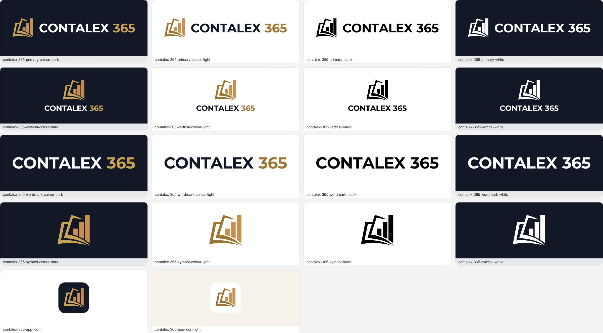

# Contalex 365

[English](#english) · [Español](#español)

## English

*Your advisers, 365 days a year.*

Contalex 365 is an advisory firm for companies and the self-employed. We handle bookkeeping, tax, payroll, company law and CAE (Coordinación de Actividades Empresariales): all the health-and-safety paperwork between companies and their contractors, kept in order 365 days a year.

Web: [contalex365.com](https://contalex365.com) · Brand page: [https://hsdg48.github.io/brand-library/brands/contalex-365/](https://hsdg48.github.io/brand-library/brands/contalex-365/)

**Logos:** [`logo/svg/`](logo/svg/) (SVG) · [`logo/png/`](logo/png/) (PNG, 512–4096 px)

**Colours:** Night Blue `#121826` · Gold `#C7A251` · Copper `#C79050` · White `#FFFFFF` · Slate `#1E2636` · Mist Grey `#8C95A6` · Deep Gold `#9C7631` · Ivory `#F6F2EA`

**Fonts:** Montserrat, Montserrat (Google Fonts)

- **Brand guide:** [Brand guide · English](guide/contalex-365-brand-guidelines-en.pdf) · [Read online · English](guide/index.en.html) · [Brand guide · Español](guide/contalex-365-brand-guidelines-es.pdf) · [Read online · Español](guide/index.html)
- **Business profile:** [Business profile · English](profile/contalex-365-business-profile-en.pdf) · [Profile text · English](profile/contalex-365-business-profile-en.md) · [Business profile · Español](profile/contalex-365-business-profile-es.pdf) · [Profile text · Español](profile/contalex-365-business-profile-es.md)
- **Stationery:** [Letterhead](stationery/letterhead-en.pdf) · [Email signature](stationery/email-signature-en.html) · [Business card](stationery/business-card-en-preview.png)
- **Icons:** [Favicon](icons/favicon.svg) · [Favicon](icons/favicon.ico) · [Apple touch icon](icons/apple-touch-icon.png) · [App icon 192](icons/icon-192.png) · [App icon 512](icons/icon-512.png) · [App icon 512 maskable](icons/icon-maskable-512.png) · [Web manifest](icons/site.webmanifest)
- **Social media images:** [`social/`](social/)

## Español

*Tu asesoría, 365 días al año.*

Contalex 365 es una asesoría para empresas y autónomos. Llevamos la contabilidad, los impuestos, la parte laboral y mercantil, y la Coordinación de Actividades Empresariales (CAE): toda la gestión documental con contratas y subcontratas, en regla los 365 días del año.

Web: [contalex365.com](https://contalex365.com) · Página de marca: [https://hsdg48.github.io/brand-library/brands/contalex-365/index.es.html](https://hsdg48.github.io/brand-library/brands/contalex-365/index.es.html)

**Logotipos:** [`logo/svg/`](logo/svg/) (SVG) · [`logo/png/`](logo/png/) (PNG, 512–4096 px)

**Colores:** Azul Noche `#121826` · Oro `#C7A251` · Cobre `#C79050` · Blanco `#FFFFFF` · Pizarra `#1E2636` · Gris Niebla `#8C95A6` · Oro Profundo `#9C7631` · Marfil `#F6F2EA`

**Tipografías:** Montserrat, Montserrat (Google Fonts)

- **Manual de marca:** [Manual de marca · Español](guide/contalex-365-brand-guidelines-es.pdf) · [Leer online · Español](guide/index.html) · [Manual de marca · English](guide/contalex-365-brand-guidelines-en.pdf) · [Leer online · English](guide/index.en.html)
- **Perfil de empresa:** [Perfil de empresa · Español](profile/contalex-365-business-profile-es.pdf) · [Texto del perfil · Español](profile/contalex-365-business-profile-es.md) · [Perfil de empresa · English](profile/contalex-365-business-profile-en.pdf) · [Texto del perfil · English](profile/contalex-365-business-profile-en.md)
- **Papelería:** [Papel con membrete](stationery/letterhead-es.pdf) · [Firma de email](stationery/email-signature-es.html) · [Tarjeta de visita](stationery/business-card-es-preview.png)
- **Iconos:** [Favicon](icons/favicon.svg) · [Favicon](icons/favicon.ico) · [Apple touch icon](icons/apple-touch-icon.png) · [App icon 192](icons/icon-192.png) · [App icon 512](icons/icon-512.png) · [App icon 512 maskable](icons/icon-maskable-512.png) · [Web manifest](icons/site.webmanifest)
- **Imágenes para redes sociales:** [`social/`](social/)

---
The logos and brand names are trademarks of their owners. You are welcome to use them to refer to the brand (press, directories, partner pages). Please don't alter them or suggest an endorsement. Guide texts and layouts: CC BY 4.0.
