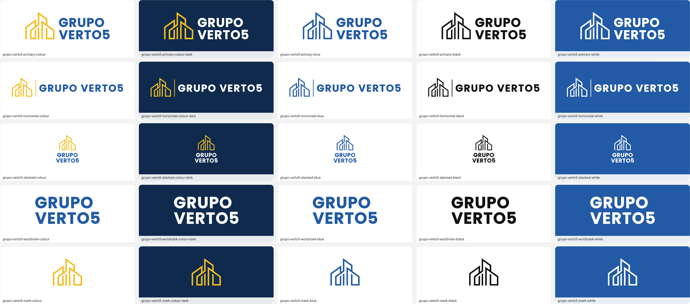

# Grupo Verto5

[English](#english) · [Español](#español)

## English

*Full project control*

Grupo Verto5 is a subcontracting and outsourcing company serving businesses across Spain, based in Bilbao. It places managed, supervised teams on construction sites, factories, warehouses and service operations, with CAE and health-and-safety paperwork in order.

Web: [grupoverto5.com](https://grupoverto5.com) · Brand page: [https://hsdg48.github.io/brand-library/brands/grupo-verto5/](https://hsdg48.github.io/brand-library/brands/grupo-verto5/)

**Logos:** [`logo/svg/`](logo/svg/) (SVG) · [`logo/png/`](logo/png/) (PNG, 512–4096 px)

**Colours:** Verto Blue `#225AA5` · Site Yellow `#F3BD1D` · Night Blue `#0F2A4D` · White `#FFFFFF` · Concrete `#5E6B7D` · Mist `#EEF3FA`

**Fonts:** Poppins, Poppins (Google Fonts)

- **Brand guide:** [Brand guide · English](guide/grupo-verto5-brand-guidelines-en.pdf) · [Read online · English](guide/index.en.html) · [Brand guide · Español](guide/grupo-verto5-brand-guidelines-es.pdf) · [Read online · Español](guide/index.html)
- **Business profile:** [Business profile · English](profile/grupo-verto5-business-profile-en.pdf) · [Profile text · English](profile/grupo-verto5-business-profile-en.md) · [Business profile · Español](profile/grupo-verto5-business-profile-es.pdf) · [Profile text · Español](profile/grupo-verto5-business-profile-es.md)
- **Stationery:** [Letterhead (alovar)](stationery/letterhead-alovar-en.pdf) · [Letterhead (cerrajeria)](stationery/letterhead-cerrajeria-en.pdf) · [Letterhead (pintura)](stationery/letterhead-pintura-en.pdf)
- **Icons:** [Favicon](icons/favicon.svg) · [Favicon](icons/favicon.ico) · [Apple touch icon](icons/apple-touch-icon.png) · [App icon 192](icons/icon-192.png) · [App icon 512](icons/icon-512.png) · [App icon 512 maskable](icons/icon-maskable-512.png) · [Web manifest](icons/site.webmanifest)
- **Social media images:** [`social/`](social/)

## Español

*Control total del proyecto*

Grupo Verto5 es una empresa de subcontratación y externalización de servicios para empresas de toda España, con sede en Bilbao. Pone equipos gestionados y supervisados en obra, industria, logística y servicios, con la documentación CAE y PRL al día.

Web: [grupoverto5.com](https://grupoverto5.com) · Página de marca: [https://hsdg48.github.io/brand-library/brands/grupo-verto5/index.es.html](https://hsdg48.github.io/brand-library/brands/grupo-verto5/index.es.html)

**Logotipos:** [`logo/svg/`](logo/svg/) (SVG) · [`logo/png/`](logo/png/) (PNG, 512–4096 px)

**Colores:** Azul Verto `#225AA5` · Amarillo Obra `#F3BD1D` · Azul Noche `#0F2A4D` · Blanco `#FFFFFF` · Hormigón `#5E6B7D` · Niebla `#EEF3FA`

**Tipografías:** Poppins, Poppins (Google Fonts)

- **Manual de marca:** [Manual de marca · Español](guide/grupo-verto5-brand-guidelines-es.pdf) · [Leer online · Español](guide/index.html) · [Manual de marca · English](guide/grupo-verto5-brand-guidelines-en.pdf) · [Leer online · English](guide/index.en.html)
- **Perfil de empresa:** [Perfil de empresa · Español](profile/grupo-verto5-business-profile-es.pdf) · [Texto del perfil · Español](profile/grupo-verto5-business-profile-es.md) · [Perfil de empresa · English](profile/grupo-verto5-business-profile-en.pdf) · [Texto del perfil · English](profile/grupo-verto5-business-profile-en.md)
- **Papelería:** [Papel con membrete (alovar)](stationery/letterhead-alovar-es.pdf) · [Papel con membrete (cerrajeria)](stationery/letterhead-cerrajeria-es.pdf) · [Papel con membrete (pintura)](stationery/letterhead-pintura-es.pdf)
- **Iconos:** [Favicon](icons/favicon.svg) · [Favicon](icons/favicon.ico) · [Apple touch icon](icons/apple-touch-icon.png) · [App icon 192](icons/icon-192.png) · [App icon 512](icons/icon-512.png) · [App icon 512 maskable](icons/icon-maskable-512.png) · [Web manifest](icons/site.webmanifest)
- **Imágenes para redes sociales:** [`social/`](social/)

---
The logos and brand names are trademarks of their owners. You are welcome to use them to refer to the brand (press, directories, partner pages). Please don't alter them or suggest an endorsement. Guide texts and layouts: CC BY 4.0.
