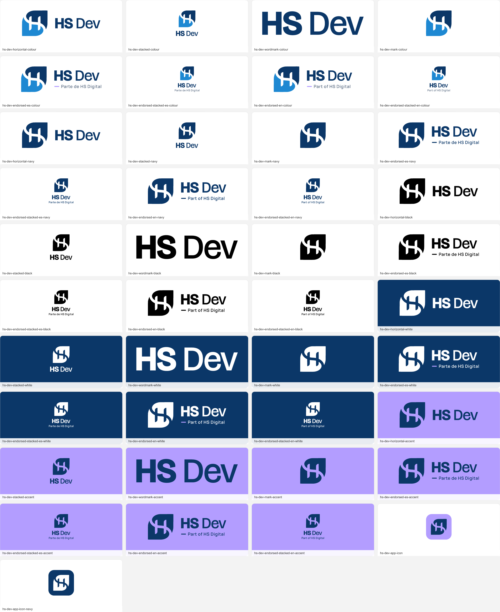

# HS Dev

[English](#english) · [Español](#español)

## English

*Websites that work. And keep working.*

HS Dev is the HS Digital group's web development and WordPress maintenance studio for small businesses in Madrid, Bilbao and across Spain. We build your website, connect it to your tools and keep it up to date.

Web: [hsdev.es](https://hsdev.es) · Brand page: [https://hsdg48.github.io/brand-library/brands/hs-dev/](https://hsdg48.github.io/brand-library/brands/hs-dev/)

**Logos:** [`logo/svg/`](logo/svg/) (SVG) · [`logo/png/`](logo/png/) (PNG, 512–4096 px)

**Colours:** Navy `#0B3768` · Blue `#1E88D2` · Violet `#B39DFF` · Violet 700 `#5634D1` · Blue 700 `#1466A6` · Sky `#E8F3FC` · Mist `#F6F9FC` · Ink `#0A1A2F` · Slate `#5A6B82` · Line `#DCE6F0`

**Fonts:** Bricolage Grotesque, Manrope (Google Fonts)

- **Brand guide:** [Brand guide · English](guide/hs-dev-brand-guidelines-en.pdf) · [Read online · English](guide/index.en.html) · [Brand guide · Español](guide/hs-dev-brand-guidelines-es.pdf) · [Read online · Español](guide/index.html)
- **Business profile:** [Business profile · English](profile/hs-dev-business-profile-en.pdf) · [Profile text · English](profile/hs-dev-business-profile-en.md) · [Business profile · Español](profile/hs-dev-business-profile-es.pdf) · [Profile text · Español](profile/hs-dev-business-profile-es.md)
- **Stationery:** [Letterhead (endorsed)](stationery/letterhead-endorsed-en.pdf) · [Email signature (endorsed)](stationery/email-signature-endorsed-en.html) · [Business card (endorsed)](stationery/business-card-endorsed-en-preview.png) · [Letterhead (standalone)](stationery/letterhead-standalone-en.pdf) · [Email signature (standalone)](stationery/email-signature-standalone-en.html) · [Business card (standalone)](stationery/business-card-standalone-en-preview.png)
- **Icons:** [Favicon](icons/favicon.svg) · [Favicon](icons/favicon.ico) · [Apple touch icon](icons/apple-touch-icon.png) · [App icon 192](icons/icon-192.png) · [App icon 512](icons/icon-512.png) · [App icon 512 maskable](icons/icon-maskable-512.png) · [Web manifest](icons/site.webmanifest)
- **Social media images:** [`social/`](social/)

## Español

*Webs que funcionan. Y que siguen funcionando.*

HS Dev es el estudio de desarrollo web y mantenimiento WordPress del grupo HS Digital, para pymes de Madrid, Bilbao y toda España. Desarrollamos tu web, la conectamos con tus herramientas y la mantenemos al día.

Web: [hsdev.es](https://hsdev.es) · Página de marca: [https://hsdg48.github.io/brand-library/brands/hs-dev/index.es.html](https://hsdg48.github.io/brand-library/brands/hs-dev/index.es.html)

**Logotipos:** [`logo/svg/`](logo/svg/) (SVG) · [`logo/png/`](logo/png/) (PNG, 512–4096 px)

**Colores:** Navy `#0B3768` · Blue `#1E88D2` · Violet `#B39DFF` · Violet 700 `#5634D1` · Blue 700 `#1466A6` · Sky `#E8F3FC` · Mist `#F6F9FC` · Ink `#0A1A2F` · Slate `#5A6B82` · Line `#DCE6F0`

**Tipografías:** Bricolage Grotesque, Manrope (Google Fonts)

- **Manual de marca:** [Manual de marca · Español](guide/hs-dev-brand-guidelines-es.pdf) · [Leer online · Español](guide/index.html) · [Manual de marca · English](guide/hs-dev-brand-guidelines-en.pdf) · [Leer online · English](guide/index.en.html)
- **Perfil de empresa:** [Perfil de empresa · Español](profile/hs-dev-business-profile-es.pdf) · [Texto del perfil · Español](profile/hs-dev-business-profile-es.md) · [Perfil de empresa · English](profile/hs-dev-business-profile-en.pdf) · [Texto del perfil · English](profile/hs-dev-business-profile-en.md)
- **Papelería:** [Papel con membrete (con respaldo)](stationery/letterhead-endorsed-es.pdf) · [Firma de email (con respaldo)](stationery/email-signature-endorsed-es.html) · [Tarjeta de visita (con respaldo)](stationery/business-card-endorsed-es-preview.png) · [Papel con membrete (independiente)](stationery/letterhead-standalone-es.pdf) · [Firma de email (independiente)](stationery/email-signature-standalone-es.html) · [Tarjeta de visita (independiente)](stationery/business-card-standalone-es-preview.png)
- **Iconos:** [Favicon](icons/favicon.svg) · [Favicon](icons/favicon.ico) · [Apple touch icon](icons/apple-touch-icon.png) · [App icon 192](icons/icon-192.png) · [App icon 512](icons/icon-512.png) · [App icon 512 maskable](icons/icon-maskable-512.png) · [Web manifest](icons/site.webmanifest)
- **Imágenes para redes sociales:** [`social/`](social/)

---
The logos and brand names are trademarks of their owners. You are welcome to use them to refer to the brand (press, directories, partner pages). Please don't alter them or suggest an endorsement. Guide texts and layouts: CC BY 4.0.
