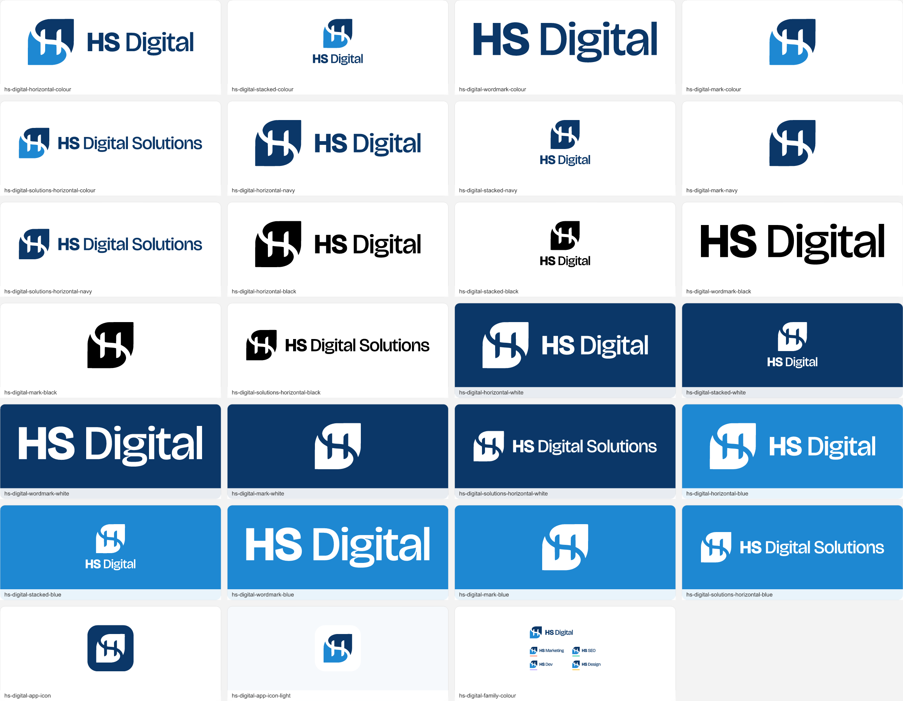

# HS Digital

[English](#english) · [Español](#español)

## English

*One group, five specialities.*

HS Digital is the group behind HS Marketing, HS SEO, HS Design and HS Dev. When your project needs more than one speciality, we solve it in-house with a single point of contact.

Web: [hsdigital.es](https://hsdigital.es) · Brand page: [https://hsdg48.github.io/brand-library/brands/hs-digital/](https://hsdg48.github.io/brand-library/brands/hs-digital/)

**Logos:** [`logo/svg/`](logo/svg/) (SVG) · [`logo/png/`](logo/png/) (PNG, 512–4096 px)

**Colours:** Navy `#0B3768` · Blue `#1E88D2` · Blue 700 `#1466A6` · Sky `#E8F3FC` · Mist `#F6F9FC` · Ink `#0A1A2F` · Slate `#5A6B82` · Line `#DCE6F0`

**Fonts:** Bricolage Grotesque, Manrope (Google Fonts)

- **Brand guide:** [Brand guide · English](guide/hs-digital-brand-guidelines-en.pdf) · [Read online · English](guide/index.en.html) · [Brand guide · Español](guide/hs-digital-brand-guidelines-es.pdf) · [Read online · Español](guide/index.html)
- **Business profile:** [Business profile · English](profile/hs-digital-business-profile-en.pdf) · [Profile text · English](profile/hs-digital-business-profile-en.md) · [Business profile · Español](profile/hs-digital-business-profile-es.pdf) · [Profile text · Español](profile/hs-digital-business-profile-es.md)
- **Stationery:** [Letterhead](stationery/letterhead-en.pdf) · [Email signature](stationery/email-signature-en.html) · [Business card](stationery/business-card-en-preview.png)
- **Icons:** [Favicon](icons/favicon.svg) · [Favicon](icons/favicon.ico) · [Apple touch icon](icons/apple-touch-icon.png) · [App icon 192](icons/icon-192.png) · [App icon 512](icons/icon-512.png) · [App icon 512 maskable](icons/icon-maskable-512.png) · [Web manifest](icons/site.webmanifest)
- **Social media images:** [`social/`](social/)

## Español

*Un grupo, cinco especialidades.*

HS Digital es el grupo de HS Marketing, HS SEO, HS Design y HS Dev. Cuando tu proyecto necesita más de una especialidad, lo resolvemos dentro de casa con una sola persona de contacto.

Web: [hsdigital.es](https://hsdigital.es) · Página de marca: [https://hsdg48.github.io/brand-library/brands/hs-digital/index.es.html](https://hsdg48.github.io/brand-library/brands/hs-digital/index.es.html)

**Logotipos:** [`logo/svg/`](logo/svg/) (SVG) · [`logo/png/`](logo/png/) (PNG, 512–4096 px)

**Colores:** Navy `#0B3768` · Blue `#1E88D2` · Blue 700 `#1466A6` · Sky `#E8F3FC` · Mist `#F6F9FC` · Ink `#0A1A2F` · Slate `#5A6B82` · Line `#DCE6F0`

**Tipografías:** Bricolage Grotesque, Manrope (Google Fonts)

- **Manual de marca:** [Manual de marca · Español](guide/hs-digital-brand-guidelines-es.pdf) · [Leer online · Español](guide/index.html) · [Manual de marca · English](guide/hs-digital-brand-guidelines-en.pdf) · [Leer online · English](guide/index.en.html)
- **Perfil de empresa:** [Perfil de empresa · Español](profile/hs-digital-business-profile-es.pdf) · [Texto del perfil · Español](profile/hs-digital-business-profile-es.md) · [Perfil de empresa · English](profile/hs-digital-business-profile-en.pdf) · [Texto del perfil · English](profile/hs-digital-business-profile-en.md)
- **Papelería:** [Papel con membrete](stationery/letterhead-es.pdf) · [Firma de email](stationery/email-signature-es.html) · [Tarjeta de visita](stationery/business-card-es-preview.png)
- **Iconos:** [Favicon](icons/favicon.svg) · [Favicon](icons/favicon.ico) · [Apple touch icon](icons/apple-touch-icon.png) · [App icon 192](icons/icon-192.png) · [App icon 512](icons/icon-512.png) · [App icon 512 maskable](icons/icon-maskable-512.png) · [Web manifest](icons/site.webmanifest)
- **Imágenes para redes sociales:** [`social/`](social/)

---
The logos and brand names are trademarks of their owners. You are welcome to use them to refer to the brand (press, directories, partner pages). Please don't alter them or suggest an endorsement. Guide texts and layouts: CC BY 4.0.
