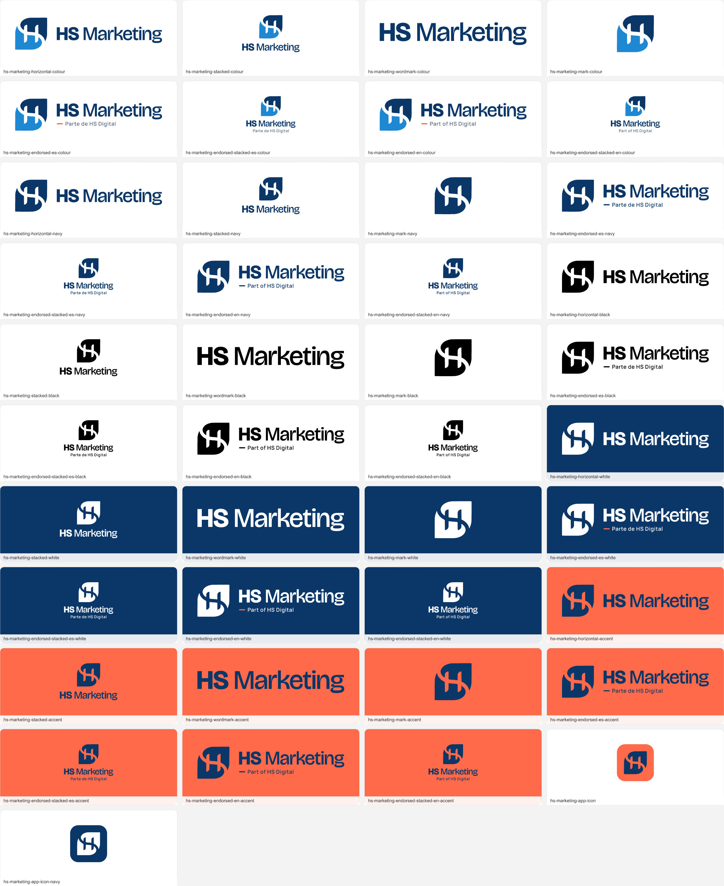

# HS Marketing

[English](#english) · [Español](#español)

## English

*Marketing you notice. Results you can measure.*

HS Marketing is HS Digital's social media and digital marketing agency for small businesses in Madrid, Bilbao and the rest of Spain. We run your social media, create content and launch ads that fill your diary.

Web: [hsmarketing.es](https://hsmarketing.es) · Brand page: [https://hsdg48.github.io/brand-library/brands/hs-marketing/](https://hsdg48.github.io/brand-library/brands/hs-marketing/)

**Logos:** [`logo/svg/`](logo/svg/) (SVG) · [`logo/png/`](logo/png/) (PNG, 512–4096 px)

**Colours:** Navy `#0B3768` · Blue `#1E88D2` · Coral `#FF6B4A` · Coral 700 `#C2401F` · Blue 700 `#1466A6` · Sky `#E8F3FC` · Mist `#F6F9FC` · Ink `#0A1A2F` · Slate `#5A6B82` · Line `#DCE6F0`

**Fonts:** Bricolage Grotesque, Manrope (Google Fonts)

- **Brand guide:** [Brand guide · English](guide/hs-marketing-brand-guidelines-en.pdf) · [Read online · English](guide/index.en.html) · [Brand guide · Español](guide/hs-marketing-brand-guidelines-es.pdf) · [Read online · Español](guide/index.html)
- **Business profile:** [Business profile · English](profile/hs-marketing-business-profile-en.pdf) · [Profile text · English](profile/hs-marketing-business-profile-en.md) · [Business profile · Español](profile/hs-marketing-business-profile-es.pdf) · [Profile text · Español](profile/hs-marketing-business-profile-es.md)
- **Stationery:** [Letterhead (endorsed)](stationery/letterhead-endorsed-en.pdf) · [Email signature (endorsed)](stationery/email-signature-endorsed-en.html) · [Business card (endorsed)](stationery/business-card-endorsed-en-preview.png) · [Letterhead (standalone)](stationery/letterhead-standalone-en.pdf) · [Email signature (standalone)](stationery/email-signature-standalone-en.html) · [Business card (standalone)](stationery/business-card-standalone-en-preview.png)
- **Icons:** [Favicon](icons/favicon.svg) · [Favicon](icons/favicon.ico) · [Apple touch icon](icons/apple-touch-icon.png) · [App icon 192](icons/icon-192.png) · [App icon 512](icons/icon-512.png) · [App icon 512 maskable](icons/icon-maskable-512.png) · [Web manifest](icons/site.webmanifest)
- **Social media images:** [`social/`](social/)

## Español

*Marketing que se nota. Resultados que se miden.*

HS Marketing es la agencia de redes sociales y marketing digital de HS Digital para pequeños negocios de Madrid, Bilbao y el resto de España. Gestionamos tus redes, creamos contenido y lanzamos anuncios que llenan tu agenda.

Web: [hsmarketing.es](https://hsmarketing.es) · Página de marca: [https://hsdg48.github.io/brand-library/brands/hs-marketing/index.es.html](https://hsdg48.github.io/brand-library/brands/hs-marketing/index.es.html)

**Logotipos:** [`logo/svg/`](logo/svg/) (SVG) · [`logo/png/`](logo/png/) (PNG, 512–4096 px)

**Colores:** Navy `#0B3768` · Blue `#1E88D2` · Coral `#FF6B4A` · Coral 700 `#C2401F` · Blue 700 `#1466A6` · Sky `#E8F3FC` · Mist `#F6F9FC` · Ink `#0A1A2F` · Slate `#5A6B82` · Line `#DCE6F0`

**Tipografías:** Bricolage Grotesque, Manrope (Google Fonts)

- **Manual de marca:** [Manual de marca · Español](guide/hs-marketing-brand-guidelines-es.pdf) · [Leer online · Español](guide/index.html) · [Manual de marca · English](guide/hs-marketing-brand-guidelines-en.pdf) · [Leer online · English](guide/index.en.html)
- **Perfil de empresa:** [Perfil de empresa · Español](profile/hs-marketing-business-profile-es.pdf) · [Texto del perfil · Español](profile/hs-marketing-business-profile-es.md) · [Perfil de empresa · English](profile/hs-marketing-business-profile-en.pdf) · [Texto del perfil · English](profile/hs-marketing-business-profile-en.md)
- **Papelería:** [Papel con membrete (con respaldo)](stationery/letterhead-endorsed-es.pdf) · [Firma de email (con respaldo)](stationery/email-signature-endorsed-es.html) · [Tarjeta de visita (con respaldo)](stationery/business-card-endorsed-es-preview.png) · [Papel con membrete (independiente)](stationery/letterhead-standalone-es.pdf) · [Firma de email (independiente)](stationery/email-signature-standalone-es.html) · [Tarjeta de visita (independiente)](stationery/business-card-standalone-es-preview.png)
- **Iconos:** [Favicon](icons/favicon.svg) · [Favicon](icons/favicon.ico) · [Apple touch icon](icons/apple-touch-icon.png) · [App icon 192](icons/icon-192.png) · [App icon 512](icons/icon-512.png) · [App icon 512 maskable](icons/icon-maskable-512.png) · [Web manifest](icons/site.webmanifest)
- **Imágenes para redes sociales:** [`social/`](social/)

---
The logos and brand names are trademarks of their owners. You are welcome to use them to refer to the brand (press, directories, partner pages). Please don't alter them or suggest an endorsement. Guide texts and layouts: CC BY 4.0.
