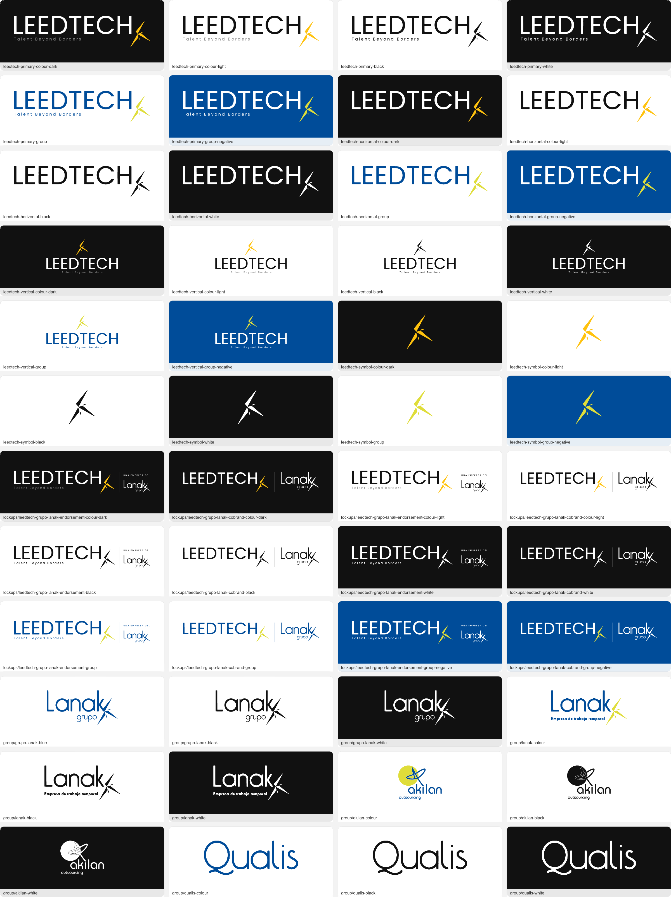

# LeedTech

[English](#english) · [Español](#español)

## English

*Talent Beyond Borders*

LeedTech is the recruitment company of Grupo Lanak. We connect qualified professionals with employers across Spain: we find, assess and support talent all the way to their first day, wherever they come from.

Web: [leedtech.es](https://leedtech.es) · Brand page: [https://hsdg48.github.io/brand-library/brands/leedtech/](https://hsdg48.github.io/brand-library/brands/leedtech/)

**Logos:** [`logo/svg/`](logo/svg/) (SVG) · [`logo/png/`](logo/png/) (PNG, 512–4096 px)

**Colours:** Ink Black `#111111` · Signal Yellow `#FFC20E` · White `#FFFFFF` · Graphite `#2B2B2B` · Grey `#8A8A8A`

**Fonts:** Outfit, Poppins (Google Fonts)

- **Brand guide:** [Brand guide · English](guide/leedtech-brand-guidelines-en.pdf) · [Read online · English](guide/index.en.html) · [Brand guide · Español](guide/leedtech-brand-guidelines-es.pdf) · [Read online · Español](guide/index.html)
- **Business profile:** [Business profile · English](profile/leedtech-business-profile-en.pdf) · [Profile text · English](profile/leedtech-business-profile-en.md) · [Business profile · Español](profile/leedtech-business-profile-es.pdf) · [Profile text · Español](profile/leedtech-business-profile-es.md)
- **Stationery:** [Letterhead (co-brand)](stationery/letterhead-cobrand-en.pdf) · [Email signature (co-brand)](stationery/email-signature-cobrand-en.html) · [Business card (co-brand)](stationery/business-card-cobrand-en-preview.png) · [Letterhead (standard)](stationery/letterhead-standard-en.pdf) · [Email signature (standard)](stationery/email-signature-standard-en.html) · [Business card (standard)](stationery/business-card-standard-en-preview.png)
- **Icons:** [Favicon](icons/favicon.svg) · [Favicon](icons/favicon.ico) · [Apple touch icon](icons/apple-touch-icon.png) · [App icon 192](icons/icon-192.png) · [App icon 512](icons/icon-512.png) · [App icon 512 maskable](icons/icon-maskable-512.png) · [Web manifest](icons/site.webmanifest)
- **Social media images:** [`social/`](social/)

## Español

*Talent Beyond Borders*

LeedTech es la empresa de selección de personal del Grupo Lanak. Conectamos a profesionales cualificados con empresas de toda España: buscamos, evaluamos y acompañamos el talento hasta su incorporación, sin importar de dónde venga.

Web: [leedtech.es](https://leedtech.es) · Página de marca: [https://hsdg48.github.io/brand-library/brands/leedtech/index.es.html](https://hsdg48.github.io/brand-library/brands/leedtech/index.es.html)

**Logotipos:** [`logo/svg/`](logo/svg/) (SVG) · [`logo/png/`](logo/png/) (PNG, 512–4096 px)

**Colores:** Negro Tinta `#111111` · Amarillo Señal `#FFC20E` · Blanco `#FFFFFF` · Grafito `#2B2B2B` · Gris `#8A8A8A`

**Tipografías:** Outfit, Poppins (Google Fonts)

- **Manual de marca:** [Manual de marca · Español](guide/leedtech-brand-guidelines-es.pdf) · [Leer online · Español](guide/index.html) · [Manual de marca · English](guide/leedtech-brand-guidelines-en.pdf) · [Leer online · English](guide/index.en.html)
- **Perfil de empresa:** [Perfil de empresa · Español](profile/leedtech-business-profile-es.pdf) · [Texto del perfil · Español](profile/leedtech-business-profile-es.md) · [Perfil de empresa · English](profile/leedtech-business-profile-en.pdf) · [Texto del perfil · English](profile/leedtech-business-profile-en.md)
- **Papelería:** [Papel con membrete (co-brand)](stationery/letterhead-cobrand-es.pdf) · [Firma de email (co-brand)](stationery/email-signature-cobrand-es.html) · [Tarjeta de visita (co-brand)](stationery/business-card-cobrand-es-preview.png) · [Papel con membrete (estándar)](stationery/letterhead-standard-es.pdf) · [Firma de email (estándar)](stationery/email-signature-standard-es.html) · [Tarjeta de visita (estándar)](stationery/business-card-standard-es-preview.png)
- **Iconos:** [Favicon](icons/favicon.svg) · [Favicon](icons/favicon.ico) · [Apple touch icon](icons/apple-touch-icon.png) · [App icon 192](icons/icon-192.png) · [App icon 512](icons/icon-512.png) · [App icon 512 maskable](icons/icon-maskable-512.png) · [Web manifest](icons/site.webmanifest)
- **Imágenes para redes sociales:** [`social/`](social/)

---
The logos and brand names are trademarks of their owners. You are welcome to use them to refer to the brand (press, directories, partner pages). Please don't alter them or suggest an endorsement. Guide texts and layouts: CC BY 4.0.
