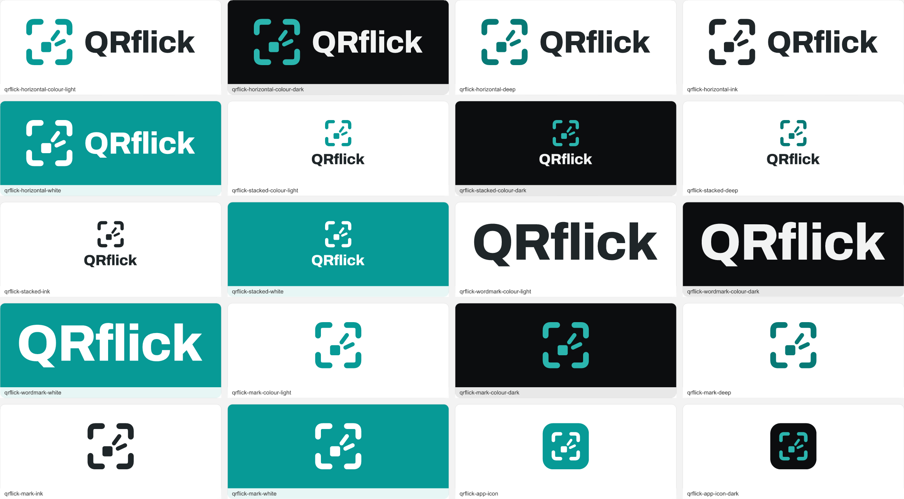

# QRflick

[English](#english) · [Español](#español)

## English

*Print once. Change forever.*

QRflick is a QR code you can change after it's printed. You print once and change where it points from your phone. Your codes keep working even if you stop paying.

Web: [qrflick.com](https://qrflick.com) · Brand page: [https://hsdg48.github.io/brand-library/brands/qrflick/](https://hsdg48.github.io/brand-library/brands/qrflick/)

**Logos:** [`logo/svg/`](logo/svg/) (SVG) · [`logo/png/`](logo/png/) (PNG, 512–4096 px)

**Colours:** Teal `#079A96` · Teal Deep `#077A76` · Teal Glow `#2BB5AE` · Ink `#1F2629` · Slate `#566266` · Line `#E2E6E5` · Paper `#F5F6F5` · Night `#0C0D0F` · Snow `#F2F3F3` · Teal Mist `#E6F4F3` · Amber `#E8A33D` · Red `#D9544D`

**Fonts:** Archivo (Google Fonts)

- **Brand guide:** [Brand guide · English](guide/qrflick-brand-guidelines-en.pdf) · [Read online · English](guide/index.en.html) · [Brand guide · Español](guide/qrflick-brand-guidelines-es.pdf) · [Read online · Español](guide/index.html)
- **Business profile:** [Business profile · English](profile/qrflick-business-profile-en.pdf) · [Profile text · English](profile/qrflick-business-profile-en.md) · [Business profile · Español](profile/qrflick-business-profile-es.pdf) · [Profile text · Español](profile/qrflick-business-profile-es.md)
- **Stationery:** [Letterhead](stationery/letterhead-en.pdf) · [Email signature](stationery/email-signature-en.html) · [Business card](stationery/business-card-en-preview.png)
- **Icons:** [Favicon](icons/favicon.svg) · [Favicon](icons/favicon.ico) · [Apple touch icon](icons/apple-touch-icon.png) · [App icon 192](icons/icon-192.png) · [App icon 512](icons/icon-512.png) · [App icon 512 maskable](icons/icon-maskable-512.png) · [Web manifest](icons/site.webmanifest)
- **Social media images:** [`social/`](social/)

## Español

*Imprime una vez. Cámbialo siempre.*

QRflick es un QR que puedes cambiar después de imprimirlo. Imprimes una vez y cambias adónde lleva desde el móvil. Tus códigos siguen funcionando aunque dejes de pagar.

Web: [qrflick.com](https://qrflick.com) · Página de marca: [https://hsdg48.github.io/brand-library/brands/qrflick/index.es.html](https://hsdg48.github.io/brand-library/brands/qrflick/index.es.html)

**Logotipos:** [`logo/svg/`](logo/svg/) (SVG) · [`logo/png/`](logo/png/) (PNG, 512–4096 px)

**Colores:** Teal `#079A96` · Teal Deep `#077A76` · Teal Glow `#2BB5AE` · Ink `#1F2629` · Slate `#566266` · Line `#E2E6E5` · Paper `#F5F6F5` · Night `#0C0D0F` · Snow `#F2F3F3` · Teal Mist `#E6F4F3` · Amber `#E8A33D` · Red `#D9544D`

**Tipografías:** Archivo (Google Fonts)

- **Manual de marca:** [Manual de marca · Español](guide/qrflick-brand-guidelines-es.pdf) · [Leer online · Español](guide/index.html) · [Manual de marca · English](guide/qrflick-brand-guidelines-en.pdf) · [Leer online · English](guide/index.en.html)
- **Perfil de empresa:** [Perfil de empresa · Español](profile/qrflick-business-profile-es.pdf) · [Texto del perfil · Español](profile/qrflick-business-profile-es.md) · [Perfil de empresa · English](profile/qrflick-business-profile-en.pdf) · [Texto del perfil · English](profile/qrflick-business-profile-en.md)
- **Papelería:** [Papel con membrete](stationery/letterhead-es.pdf) · [Firma de email](stationery/email-signature-es.html) · [Tarjeta de visita](stationery/business-card-es-preview.png)
- **Iconos:** [Favicon](icons/favicon.svg) · [Favicon](icons/favicon.ico) · [Apple touch icon](icons/apple-touch-icon.png) · [App icon 192](icons/icon-192.png) · [App icon 512](icons/icon-512.png) · [App icon 512 maskable](icons/icon-maskable-512.png) · [Web manifest](icons/site.webmanifest)
- **Imágenes para redes sociales:** [`social/`](social/)

---
The logos and brand names are trademarks of their owners. You are welcome to use them to refer to the brand (press, directories, partner pages). Please don't alter them or suggest an endorsement. Guide texts and layouts: CC BY 4.0.
