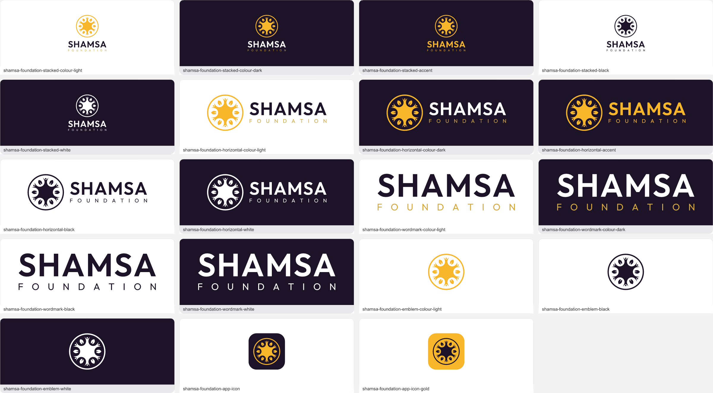

# Shamsa Foundation

[English](#english) · [Español](#español)

## English

*Light for every home.*

Shamsa Foundation is a community welfare foundation in Pakistan. Like the sun it is named after, it reaches every home: we support families in need with education, basic health care, food relief and skills for a steady income, working hand in hand with local volunteers.

Brand page: [https://hsdg48.github.io/brand-library/brands/shamsa-foundation/](https://hsdg48.github.io/brand-library/brands/shamsa-foundation/)

**Logos:** [`logo/svg/`](logo/svg/) (SVG) · [`logo/png/`](logo/png/) (PNG, 512–4096 px)

**Colours:** Sun Gold `#F8B62A` · Midnight `#1D1329` · Wheat `#D6A93E` · Amber Deep `#9A6700` · Dusk `#5F5870` · Cream `#FFF7E6` · Line `#EDE3CF` · White `#FFFFFF`

**Fonts:** Outfit, Poppins, Noto Nastaliq Urdu (Google Fonts)

- **Brand guide:** [Brand guide · English](guide/shamsa-foundation-brand-guidelines-en.pdf) · [Read online · English](guide/index.en.html)
- **Stationery:** [Letterhead](stationery/letterhead-en.pdf) · [Email signature](stationery/email-signature-en.html) · [Business card](stationery/business-card-en-preview.png)
- **Icons:** [Favicon](icons/favicon.svg) · [Favicon](icons/favicon.ico) · [Apple touch icon](icons/apple-touch-icon.png) · [App icon 192](icons/icon-192.png) · [App icon 512](icons/icon-512.png) · [App icon 512 maskable](icons/icon-maskable-512.png) · [Web manifest](icons/site.webmanifest)
- **Social media images:** [`social/`](social/)

## Español

*Light for every home.*

Shamsa Foundation is a community welfare foundation in Pakistan. Like the sun it is named after, it reaches every home: we support families in need with education, basic health care, food relief and skills for a steady income, working hand in hand with local volunteers.

Página de marca: [https://hsdg48.github.io/brand-library/brands/shamsa-foundation/index.es.html](https://hsdg48.github.io/brand-library/brands/shamsa-foundation/index.es.html)

**Logotipos:** [`logo/svg/`](logo/svg/) (SVG) · [`logo/png/`](logo/png/) (PNG, 512–4096 px)

**Colores:** Sun Gold `#F8B62A` · Midnight `#1D1329` · Wheat `#D6A93E` · Amber Deep `#9A6700` · Dusk `#5F5870` · Cream `#FFF7E6` · Line `#EDE3CF` · White `#FFFFFF`

**Tipografías:** Outfit, Poppins, Noto Nastaliq Urdu (Google Fonts)

- **Manual de marca:** [Manual de marca · English](guide/shamsa-foundation-brand-guidelines-en.pdf) · [Leer online · English](guide/index.en.html)
- **Iconos:** [Favicon](icons/favicon.svg) · [Favicon](icons/favicon.ico) · [Apple touch icon](icons/apple-touch-icon.png) · [App icon 192](icons/icon-192.png) · [App icon 512](icons/icon-512.png) · [App icon 512 maskable](icons/icon-maskable-512.png) · [Web manifest](icons/site.webmanifest)
- **Imágenes para redes sociales:** [`social/`](social/)

---
The logos and brand names are trademarks of their owners. You are welcome to use them to refer to the brand (press, directories, partner pages). Please don't alter them or suggest an endorsement. Guide texts and layouts: CC BY 4.0.
