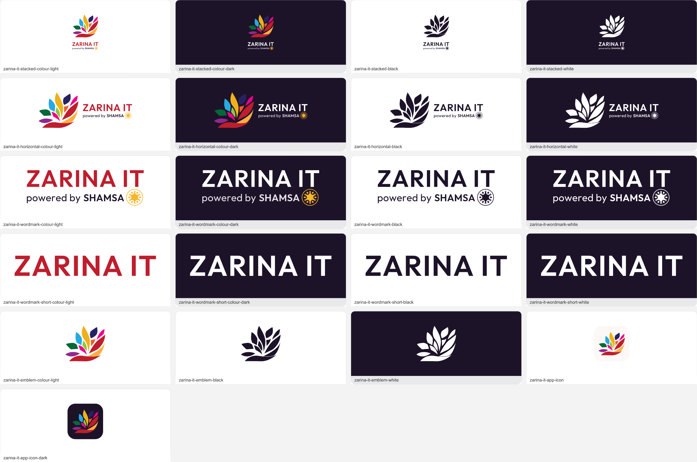

# Zarina IT

[English](#english) · [Español](#español)

## English

*Skills for a brighter future.*

Zarina IT is the technology programme of Shamsa Foundation. We teach practical computer and digital skills to young people and women, and we offer affordable IT services to local families, schools and small businesses. Fees from the services help keep the classes free or low-cost.

Brand page: [https://hsdg48.github.io/brand-library/brands/shamsa-foundation/zarina-it/](https://hsdg48.github.io/brand-library/brands/shamsa-foundation/zarina-it/)

**Logos:** [`logo/svg/`](logo/svg/) (SVG) · [`logo/png/`](logo/png/) (PNG, 512–4096 px)

**Colours:** Zarina Red `#BE1E2D` · Ink `#1D1329` · Navy `#262262` · Sky `#25AAE1` · Magenta `#EC008C` · Sun Yellow `#EFB01B` · Light Orange `#FBAF42` · Orange `#F15A29` · Green `#8CC63F` · Forest `#056839` · Purple `#92278F` · Paper `#FBF8F6` · Line `#EEE5DE`

**Fonts:** Outfit, Poppins, Noto Nastaliq Urdu (Google Fonts)

- **Brand guide:** [Brand guide · English](guide/zarina-it-brand-guidelines-en.pdf) · [Read online · English](guide/index.en.html)
- **Stationery:** [Letterhead](stationery/letterhead-en.pdf) · [Business card](stationery/business-card-en-preview.png)
- **Icons:** [Favicon](icons/favicon.svg) · [Favicon](icons/favicon.ico) · [Apple touch icon](icons/apple-touch-icon.png) · [App icon 192](icons/icon-192.png) · [App icon 512](icons/icon-512.png) · [App icon 512 maskable](icons/icon-maskable-512.png) · [Web manifest](icons/site.webmanifest)
- **Social media images:** [`social/`](social/)

## Español

*Skills for a brighter future.*

Zarina IT is the technology programme of Shamsa Foundation. We teach practical computer and digital skills to young people and women, and we offer affordable IT services to local families, schools and small businesses. Fees from the services help keep the classes free or low-cost.

Página de marca: [https://hsdg48.github.io/brand-library/brands/shamsa-foundation/zarina-it/index.es.html](https://hsdg48.github.io/brand-library/brands/shamsa-foundation/zarina-it/index.es.html)

**Logotipos:** [`logo/svg/`](logo/svg/) (SVG) · [`logo/png/`](logo/png/) (PNG, 512–4096 px)

**Colores:** Zarina Red `#BE1E2D` · Ink `#1D1329` · Navy `#262262` · Sky `#25AAE1` · Magenta `#EC008C` · Sun Yellow `#EFB01B` · Light Orange `#FBAF42` · Orange `#F15A29` · Green `#8CC63F` · Forest `#056839` · Purple `#92278F` · Paper `#FBF8F6` · Line `#EEE5DE`

**Tipografías:** Outfit, Poppins, Noto Nastaliq Urdu (Google Fonts)

- **Manual de marca:** [Manual de marca · English](guide/zarina-it-brand-guidelines-en.pdf) · [Leer online · English](guide/index.en.html)
- **Iconos:** [Favicon](icons/favicon.svg) · [Favicon](icons/favicon.ico) · [Apple touch icon](icons/apple-touch-icon.png) · [App icon 192](icons/icon-192.png) · [App icon 512](icons/icon-512.png) · [App icon 512 maskable](icons/icon-maskable-512.png) · [Web manifest](icons/site.webmanifest)
- **Imágenes para redes sociales:** [`social/`](social/)

---
The logos and brand names are trademarks of their owners. You are welcome to use them to refer to the brand (press, directories, partner pages). Please don't alter them or suggest an endorsement. Guide texts and layouts: CC BY 4.0.
