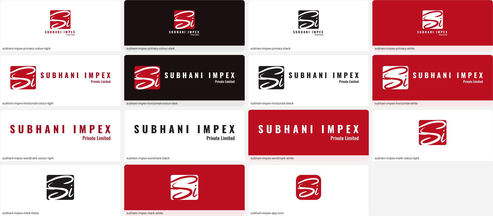

# Subhani Impex

[English](#english) · [Español](#español)

## English

*Gateway to Global Business Growth*

Subhani Impex is a multi-service company operating from Spain and Pakistan. We bring textiles, fashion production, import/export, logistics, digital solutions and B2B connections together under one roof, so brands and businesses can grow across borders with one trusted partner.

Web: [subhaniimpex.com](https://subhaniimpex.com) · Brand page: [https://hsdg48.github.io/brand-library/brands/subhani-impex/](https://hsdg48.github.io/brand-library/brands/subhani-impex/)

**Logos:** [`logo/svg/`](logo/svg/) (SVG) · [`logo/png/`](logo/png/) (PNG, 512–4096 px)

**Colours:** Subhani Red `#BB0F1F` · Deep Red `#A00D1F` · Saffron Gold `#D99A1E` · Deep Saffron `#946508` · Bright Saffron `#F2B640` · Ink `#1F1A1B` · Stone `#6E6668` · Linen `#F7F2EC` · Line `#E8E0D8` · Night `#1A1012`

**Fonts:** Oswald, Raleway (Google Fonts)

- **Brand guide:** [Brand guide · English](guide/subhani-impex-brand-guidelines-en.pdf) · [Read online · English](guide/index.en.html)
- **Business profile:** [Business profile · English](profile/subhani-impex-business-profile-en.pdf) · [Profile text · English](profile/subhani-impex-business-profile-en.md)
- **Stationery:** [Letterhead](stationery/letterhead-en.pdf) · [Email signature](stationery/email-signature-en.html) · [Business card](stationery/business-card-en-preview.png)
- **Icons:** [Favicon](icons/favicon.svg) · [Favicon](icons/favicon.ico) · [Apple touch icon](icons/apple-touch-icon.png) · [App icon 192](icons/icon-192.png) · [App icon 512](icons/icon-512.png) · [App icon 512 maskable](icons/icon-maskable-512.png) · [Web manifest](icons/site.webmanifest)
- **Social media images:** [`social/`](social/)

## Español

*Gateway to Global Business Growth*

Subhani Impex is a multi-service company operating from Spain and Pakistan. We bring textiles, fashion production, import/export, logistics, digital solutions and B2B connections together under one roof, so brands and businesses can grow across borders with one trusted partner.

Web: [subhaniimpex.com](https://subhaniimpex.com) · Página de marca: [https://hsdg48.github.io/brand-library/brands/subhani-impex/index.es.html](https://hsdg48.github.io/brand-library/brands/subhani-impex/index.es.html)

**Logotipos:** [`logo/svg/`](logo/svg/) (SVG) · [`logo/png/`](logo/png/) (PNG, 512–4096 px)

**Colores:** Subhani Red `#BB0F1F` · Deep Red `#A00D1F` · Saffron Gold `#D99A1E` · Deep Saffron `#946508` · Bright Saffron `#F2B640` · Ink `#1F1A1B` · Stone `#6E6668` · Linen `#F7F2EC` · Line `#E8E0D8` · Night `#1A1012`

**Tipografías:** Oswald, Raleway (Google Fonts)

- **Manual de marca:** [Manual de marca · English](guide/subhani-impex-brand-guidelines-en.pdf) · [Leer online · English](guide/index.en.html)
- **Perfil de empresa:** [Perfil de empresa · English](profile/subhani-impex-business-profile-en.pdf) · [Texto del perfil · English](profile/subhani-impex-business-profile-en.md)
- **Iconos:** [Favicon](icons/favicon.svg) · [Favicon](icons/favicon.ico) · [Apple touch icon](icons/apple-touch-icon.png) · [App icon 192](icons/icon-192.png) · [App icon 512](icons/icon-512.png) · [App icon 512 maskable](icons/icon-maskable-512.png) · [Web manifest](icons/site.webmanifest)
- **Imágenes para redes sociales:** [`social/`](social/)

---
The logos and brand names are trademarks of their owners. You are welcome to use them to refer to the brand (press, directories, partner pages). Please don't alter them or suggest an endorsement. Guide texts and layouts: CC BY 4.0.
